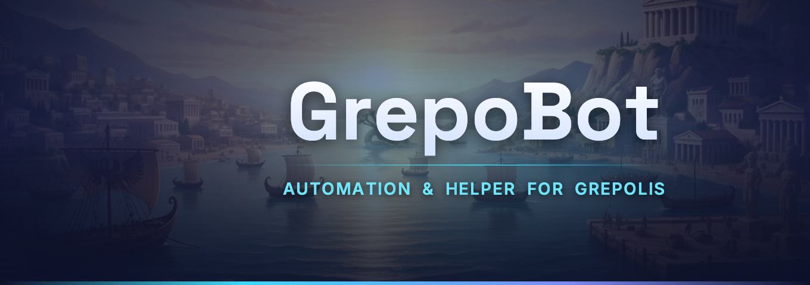

<p align="center">
  
</p>

# GrepoBot Discord bot

The community bot of the GrepoBot Discord server. It runs on a Raspberry Pi 3B+ (or any 64-bit Linux / Windows machine) and is written in C# (.NET 10, [Discord.Net](https://github.com/discord-net/Discord.Net)).

## Features

| Feature | How |
|---|---|
| **Post release updates as GrepoBot** | Write the update yourself in a hidden channel (text, images, files, emojis, server stickers). Right click it → **Apps → Post as GrepoBot** → pick a channel and a color → **Post & ping @everyone**, **Post**, or **Post & ping @role** (when `/setup updates-role` is set). The copy is a card with a colored line on the left (GrepoBot cyan, blue, green, gold, orange, red, purple; the first image sits inside the card), or a plain message with *No color line*. The last picked color is preselected next time. Posts in announcement channels are published to following servers. Fixed a typo in the draft? Right click the draft → **Apps → Update GrepoBot post**. |
| **Release cards** | Write the release as a normal message, first line the version, then sections:<br>`1.4.0 - Building is back!` · an optional intro · `New` / `Improved` / `Fixed` (also *Features*, *Added*, *Changes*, *Fixes*, *Bugs*, *Removed*, with or without `#`, `**` or `:`; any other `# Heading` works too) · bullets with `-`, `*` or `•`. Attach screenshots if you like. Right click it → **Apps → Post as release** shows the finished card privately: a banner the bot draws with the version and the headline, "🚀 GrepoBot 1.4.0 is here!", the sections, your screenshots, a thank-you and **Download**, **Changelog**, **Features** and **Ideas & bugs** buttons. Pick the channel (🔔 updates is preselected) and **Post & ping @everyone** or **Post**. Fixed a typo? Edit the draft, right click → **Apps → Update GrepoBot post**. |
| **Support tickets** | `/tickets setup category staff-role [log-channel]` and `/tickets panel channel` post a panel with one **Open a ticket** button. The form asks for a topic (dropdown: *Download & installation*, *Login*, *Feature problem*, *Something else*), a one-line subject and a description, and opens a private channel for the member and the team. The ticket shows the member's request big on top, then how to take and paste screenshots on Windows and macOS. **Close** (optional reason, the member gets a DM), **Claim**, **Reopen**, **Delete**; `/ticket add · remove · close · claim` inside a ticket, `/tickets list · message`. Opened, closed and deleted tickets are logged, no transcripts. Running `/tickets panel` again updates the existing panel. |
| **Feedback forum** | `/forum setup channel` configures a forum channel: guidelines, member tags 🆕 Feature · 🪲 Bug · 💡 Idea (one is required), team-only status tags 📌 Planned · ✅ Done · 🚫 Declined · 🔁 Duplicate, one new post per member every 2 minutes. Every new post gets ✅ / ❌ vote reactions and a short thank-you. Inside a post the team uses `/forum status` (Planned keeps the post open; Done, Declined and Duplicate lock it like a closed GitHub issue and notify the author) and `/forum reopen`. Declined and duplicate posts are deleted 14 days after closing (`delete-after-days`). |
| **Direct messages** | Members who message the bot get a polite automatic answer (at most once an hour): it is a bot, 1-on-1 help goes through a ticket, ideas and bugs into the forum. |
| **Purge** | `/purge messages count:50 [user]`, `/purge all` (delete everything, or recreate the channel instantly), right click → **Apps → Purge from here**. |
| **Automatic answers** | `/autoreply add name:install-help` opens a form for keywords and the answer. When a member's message contains a keyword, the bot replies with the answer. Whole words, case and accents ignored, `instal*` matches word endings, modes *Any* / *All* / *Regex*, cooldown per channel. `/autoreply list · show · edit · toggle · remove · test · ignore · settings`. |
| **Rules & member role** | `/rules post channel role` posts the rules with an *I have read and accept the rules* button that gives the member role. `/rules edit` changes them in place. |
| **Welcome messages** | `/welcome setup channel` with placeholders `{user} {username} {server} {rules} {membercount}`, `/welcome test`, `/welcome disable`. Every welcome carries a personal card: the member's avatar and name on the GrepoBot harbour, a random Grepolis joke ("… sailed in with a fleet of biremes.") and the member number. |
| **Self roles** | `/roles panel` posts buttons that give or remove up to 5 roles, e.g. *Updates* (pinged on releases) or languages. Roles with moderator permissions are refused. |
| **Moderation log** | `/setup log-channel` logs deleted and edited messages, joins (with a warning for accounts younger than 7 days), leaves, bans and unbans. |
| **Server setup** | `/server setup` (Administrator) shows a preview of what it would change, **Apply** does it: roles (GrepoBot Team gold, Moderator green, Supporter pink, shown separately right below the bot; old roles *Contributor*, *WebMaster* and *Bot* are deleted), the channel layout below, the rules, both forums, tickets, the welcome channel, the permanent invite, the status card and the links card. Running it again only fixes what differs. |
| **App status** | `/status set state:[Working ✅ · Not working ❌ · Maintenance 🔧] [note] [announce]` (Manage Threads) updates the pinned status card in 📡 bot-status and the channel's emoji (Discord allows two renames per 10 minutes). `announce` also posts a short new message. |
| **Settings & look** | `/setup show · updates-role · auto-publish · branding` (sets the bot's avatar and profile banner). `/about` for everyone. |

All admin commands are hidden from members who lack *Manage Server* (purge: *Manage Messages*, roles: *Manage Roles*); you can fine-tune who sees which command in **Server Settings → Integrations → GrepoBot**.

## 1. Create the Discord application

1. Open the [Developer Portal](https://discord.com/developers/applications) → **New Application** → name it `GrepoBot`.
2. **General Information**: App Icon = `src/GrepoBot.Discord/Assets/avatar.png`, add a short description.
3. **Bot**:
   - Icon = `avatar.png`, Banner = `banner.png` (both in `src/GrepoBot.Discord/Assets`). You can also do this later with `/setup branding`.
   - Turn **Public Bot** off, so only you can add it to servers.
   - Under **Privileged Gateway Intents** turn on **Server Members Intent** and **Message Content Intent** (needed for welcome messages and automatic answers).
   - **Reset Token** and keep the token for step 3. Never share or commit it.
4. **Installation**: Install Link = *None*. Invite the bot with this link (replace `APP_ID` with the *Application ID* from General Information):
   ```
   https://discord.com/oauth2/authorize?client_id=APP_ID&scope=bot+applications.commands&permissions=8
   ```
   `permissions=8` is Administrator, the bot acts as a server admin.
5. **Server Settings → Roles**: drag the **GrepoBot** role above the member role and the updates role, otherwise it cannot give them.

## 2. Prepare the Raspberry Pi

1. Flash **Raspberry Pi OS Lite (64-bit)** with [Raspberry Pi Imager](https://www.raspberrypi.com/software/). In the Imager's settings set the hostname `grepobot-pi`, the user `pi` with a password, your Wi-Fi (skip it when using a cable), and enable **SSH**.
2. Boot the Pi and log in once from Windows to check it is reachable:
   ```powershell
   ssh pi@grepobot-pi.local
   ```
   If `.local` does not resolve, use the Pi's IP address from your router.
3. Set up key login so deploys do not ask for a password (run on Windows, once):
   ```powershell
   ssh-keygen -t ed25519   # only if you have no key yet, accept the defaults
   type $env:USERPROFILE\.ssh\id_ed25519.pub | ssh pi@grepobot-pi.local "mkdir -p ~/.ssh && cat >> ~/.ssh/authorized_keys"
   ```
4. Optional but recommended: `sudo apt update && sudo apt full-upgrade -y`.

No .NET install is needed on the Pi, the bot is published self-contained (~90 MB).

## 3. Deploy

From the repository on Windows:

```powershell
echo "pi@grepobot-pi.local" > deploy/target.local   # once: your Pi's ssh login (gitignored, stays private)
./deploy/deploy.ps1                       # Windows, or: ./deploy/deploy.ps1 -Target pi@grepobot-pi.local
./deploy/deploy.sh                        # macOS / Linux, or: ./deploy/deploy.sh pi@grepobot-pi.local
```

It runs the tests, publishes for `linux-arm64`, uploads the result and runs `deploy/install.sh` on the Pi, which installs the bot to `/opt/grepobot-discord` as a systemd service running under its own `grepobot` user.

On the first install, put the token and the server ID into the settings file on the Pi:

```bash
sudo nano /etc/grepobot-discord/grepobot-discord.env
sudo systemctl restart grepobot-discord
journalctl -u grepobot-discord -f          # watch the log, Ctrl+C to leave
```

The service starts with the Pi, waits for the network and restarts automatically after a crash. Discord.Net reconnects by itself when Wi-Fi drops. Settings changed through commands are saved in `/var/lib/grepobot-discord/state.json`; back it up if you reinstall the Pi.

Later updates: just run `./deploy/deploy.ps1` (or `./deploy/deploy.sh`) again.

Once per Pi, `deploy/pi-prepare.sh` makes it lean: network over the cable only (Wi-Fi and Bluetooth are switched off in the firmware, so they stay off after restarts; it refuses to run while the cable has no address), boot to the console without the desktop and without remote desktop (xrdp). The undo steps are at the top of the script.

```bash
PI=$(cat deploy/target.local); scp deploy/pi-prepare.sh "$PI:~" && ssh -t "$PI" 'sudo bash ~/pi-prepare.sh && sudo reboot'
```

## 4. First setup on the server

1. `/setup updates-role role:@Updates` – the role pinged by *Post & ping*.
2. `/roles panel channel:#roles title:Notifications role1:@Updates` – members opt in to release pings.
3. `/rules post channel:#rules role:@Member` – edit the text in the form and submit. Then lock the server: deny *View Channel* for `@everyone` on your categories, allow it for `@Member`, and keep `#rules` and `#welcome` visible to `@everyone`.
4. `/welcome setup channel:#welcome` and `/welcome test`.
5. `/setup log-channel channel:#mod-log` (a staff-only channel).
6. `/forum setup channel:#feedback` on a forum channel. Give the moderator role **Manage Threads**, Discord requires it for team-only tags and locking posts.
7. `/tickets setup` and `/tickets panel` (the bot never auto-replies in the ticket category), then add automatic answers, e.g. `/autoreply add name:download` with keywords `download, install*, where to get` and the answer `You can download GrepoBot at https://grepobot.net`.

## Running locally

Copy `src/GrepoBot.Discord/appsettings.Local.example.json` to `appsettings.Local.json` in the same folder (gitignored), fill in the token and server ID, then:

```powershell
dotnet run --project src/GrepoBot.Discord
```

Each instance only answers interactions of its own `GuildId`, so a local run against a test server can use the same token while the Pi serves the main server. For the main server itself, stop the Pi first (`sudo systemctl stop grepobot-discord`).

## Good to know

- Attachments are re-uploaded, so the post does not depend on the draft. The bot can upload at most the server's upload limit per message (10 MB without boosts).
- Custom emojis from any server the bot is in work; stickers only if they belong to this server. Voice messages cannot be reposted.
- Drafts longer than 2000 characters (Nitro allows 4000) are posted as several messages.
- Discord only bulk-deletes messages younger than 14 days. Older ones are deleted one by one, about one per second; *Recreate channel* is instant but gives the channel a new ID.
- Deleted-message logs only show the content of messages sent while the bot was running.
- Forum posts drop out of the channel list after a week without activity (the longest Discord allows), they stay in the forum and come back on the next reply.
- The welcome card and the banner use the fonts of grepobot.net (Space Grotesk and Inter, `Assets/Fonts`, SIL Open Font License). Names in other scripts fall back to installed fonts; `install.sh` installs `libfontconfig1` and `fonts-dejavu-core` on the Pi.
- Rules, links, status, the ticket panel and welcome messages are Components v2 cards (a container with the logo, text, images and buttons inside). Their text is limited to 4000 characters per message, so the rules and the ticket panel text take at most 3600.
- Discord does not let a bot edit its own role: set the **GrepoBot** role's color (`#3FD8F5`, the icon's cyan), its position at the very top and *Display role members separately* by hand. `/server setup` reminds you.
- The bot's status rotates every 5 minutes through `Logic/BotStatuses` ("Running cities for the players 🏛️", ...). `Discord__Status` sets a fixed one instead.

### Tools

The layout lives in `Logic/ServerLayout.cs`; `/server setup` applies it. It renames and moves existing channels, creates missing ones, creates the bot's permanent invite (in 👋 welcome, never expires, reused on later runs; it is the invite used on grepobot.net) and moves every other public channel into a *Delete me* category. It never deletes a channel; staff, voice and ticket channels stay as they are.

Run tools from the repository root (`dotnet run tools/<name>.cs -- ...`). The ones talking to Discord read the token from `DISCORD_TOKEN` or `appsettings.Local.json`.

- `make-banner.cs` (Windows or macOS) regenerates `banner.png` (wordmark only, the avatar already shows the robot; the text stays clear of the profile's ⋯ button), `welcome-background.png` (the welcome card's background) and `avatar.png` from the GrepoBot app's artwork: `-- <login_background.png> <grepobot_icon_large.png> <grepobot_icon_bg.png> <out dir>`.
- `set-profile.cs` uploads `Assets/banner.png` as the bot's profile banner, and an avatar when given: `-- [avatar.png]`.

### Channel layout

| Category | Channels |
|---|---|
| 💡 Important | 👋 welcome · 📑 rules · 🔔 updates (releases and news) · ✅ bot-status (status card) · 🔗 links (website, download, features, changelog, invite) – all read-only except welcome |
| 🔥 General | 💬 general · 🙋 help (quick questions about any feature) · 💡 features-and-bugs (forum) · 🏗️ templates (forum for building templates, farming setups, culture plans, scripts) · 📸 showcase · 🎲 off-topic |
| 💎 Supporters | 💎 supporter-lounge · 🧪 early-access (read-only) – only Supporter, GrepoBot Team and Moderator see it; give the Supporter role by hand (Patreon's Discord integration can do it later) |
| 🛟 Support | 🆘 support-ticket (ticket panel) and the ticket channels |
| ⛔ PRIVATE | staff channels, untouched |

There is no channel per bot feature: questions go to 🙋 help, ideas and bugs to the forum (its tags say what a post is about), private problems to a ticket. The changelog lives on the website.
